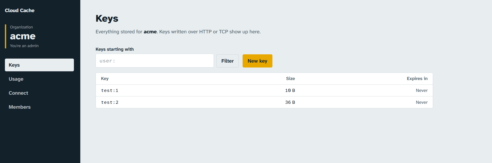
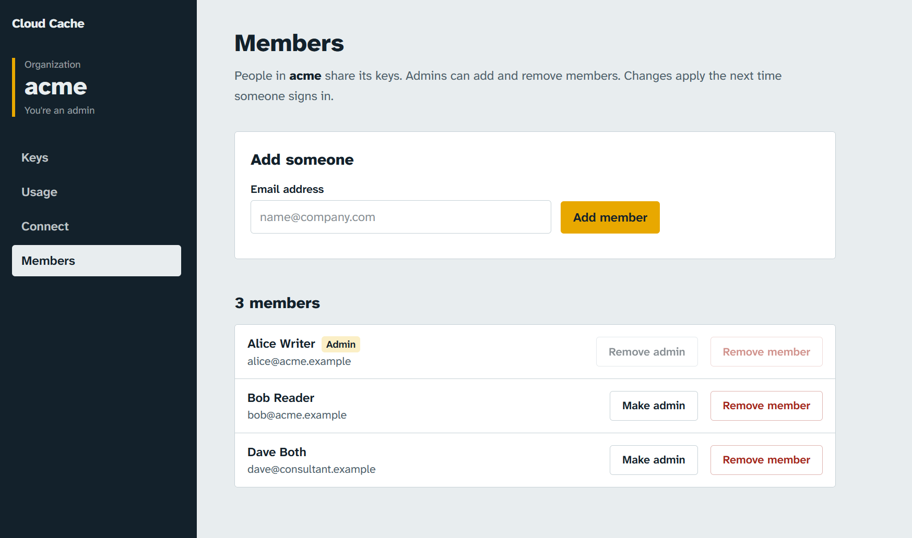
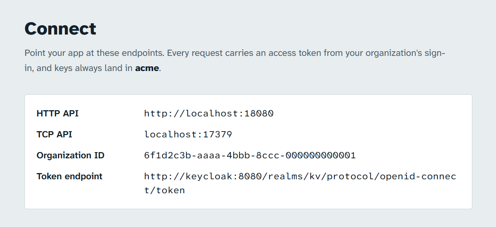
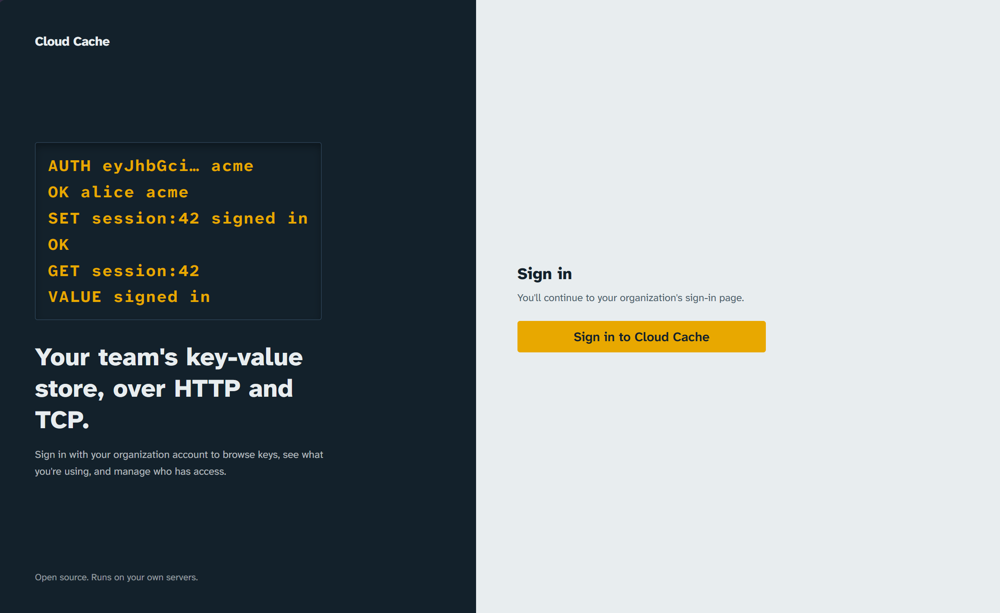

# Cloud Cache

**A multi-tenant key-value store in Rust, with an HTTP API, a TCP API and a web dashboard, secured by the OpenID Connect provider you already run.**

Cloud Cache stores keys and values in memory, isolates them per organization, and checks every request against access tokens from Keycloak, Auth0, Microsoft Entra ID, Zitadel or any other OIDC provider. It's built to sit behind a load balancer: health checks, graceful draining and an HAProxy config are included. A Next.js dashboard lets people browse keys, see their usage and manage their team.

- **Two APIs, one store:** REST over HTTP for anything, and a lightweight line-based TCP protocol for low-overhead clients. A key written through one is readable through the other.
- **Bring your own identity provider:** tokens are verified locally against the provider's published keys. There's no call to the provider per request. Presets cover Keycloak, Auth0, Entra ID, Zitadel and single-tenant setups, and any claim can be remapped with environment variables.
- **Multi-tenant by organization:** every key belongs to an org, and everyone in the org shares it. People in several orgs pick one per request. You can also run it single-tenant.
- **Roles:** read, write and usage permissions come from roles in the token. Org admins are recognized per org.
- **Built for load balancers:** `/healthz` and `/readyz`, a drain window on shutdown, consistent-hash routing in HAProxy, and per-node usage counters.
- **Web dashboard:** a key browser and editor, usage readouts, connection instructions and member management. Members can be managed for Keycloak today, and the adapter is pluggable.
- **Expiry:** set a time-to-live on any key. Expired keys are removed in the background.

## Screenshots

The dashboard, signed in as an org admin in the demo:



| Usage across all nodes | Managing members |
| --- | --- |
|  |  |

| Connection instructions | Sign-in | On a phone |
| --- | --- | --- |
|  |  |  |

> **Status:** early and actively developed. Data lives in memory only, with no persistence or replication yet. See [Limitations and roadmap](#limitations-and-roadmap) before using it for anything you can't afford to lose.

---

## Contents

- [Screenshots](#screenshots)
- [Architecture](#architecture)
- [Quick start](#quick-start)
- [Core concepts](#core-concepts)
- [Identity providers](#identity-providers)
- [HTTP API](#http-api)
- [TCP API](#tcp-api)
- [Dashboard](#dashboard)
- [Deployment](#deployment)
- [Configuration reference](#configuration-reference)
- [Security model](#security-model)
- [Operations](#operations)
- [Development](#development)
- [Troubleshooting](#troubleshooting)
- [Limitations and roadmap](#limitations-and-roadmap)
- [Contributing](#contributing)
- [License](#license)

---

## Architecture

```
                         ┌────────────────────────────┐
   browser ─────────────▶│  Dashboard (Next.js)       │──┐  user's token,
                         │  sign-in, keys, usage,     │  │  X-Org-Id
                         │  members                   │  │
                         └─────────────┬──────────────┘  │
                       sign-in (OIDC)  │                 │
                                       ▼                 ▼
 ┌──────────────────────┐      ┌───────────────────────────────┐
 │ Identity provider    │      │  Load balancer (HAProxy)      │
 │ Keycloak / Auth0 /   │      │  HTTP: hash of key path       │
 │ Entra / Zitadel / …  │      │  TCP:  sticky by client IP    │
 └──────────┬───────────┘      └──────┬──────────┬──────────┬──┘
            │ signing keys (JWKS)     ▼          ▼          ▼
            │                  ┌──────────┐┌──────────┐┌──────────┐
            └─────────────────▶│ node kv1 ││ node kv2 ││ node kv3 │
                               │ HTTP+TCP ││ HTTP+TCP ││ HTTP+TCP │
   apps / services ───────────▶│ in-memory││ in-memory││ in-memory│
   (bearer token)   via LB     └──────────┘└──────────┘└──────────┘
```

| Component | What it is | Where |
|---|---|---|
| Cloud Cache node | A single Rust binary that serves HTTP (`:8080`) and TCP (`:7379`) | `src/` |
| Load balancer | Spreads traffic, health-checks nodes and drains them on shutdown | `deploy/haproxy/haproxy.cfg` |
| Identity provider | Issues the tokens. Keycloak runs in the demo; any OIDC provider works. | `deploy/keycloak/kv-realm.json` |
| Dashboard | The web console for people | `dashboard/` |

### Repository layout

```
.
├── src/
│   ├── main.rs        process entry: config, signals
│   ├── lib.rs         startup: listeners, key loader, TTL sweeper, drain
│   ├── config.rs      environment → Config
│   ├── auth.rs        token verification (signature, iss, aud, exp; JWKS + discovery)
│   ├── identity.rs    claims → user, roles, orgs, admins (presets + ClaimMapper trait)
│   ├── store.rs       per-org in-memory store, TTL, listing, usage counters
│   ├── http.rs        HTTP API (axum)
│   └── tcp.rs         TCP line protocol
├── tests/e2e.rs       end-to-end tests (real listeners, mock identity provider)
├── Dockerfile         Cloud Cache image
├── dashboard/         Next.js 16 web console (has its own README)
├── deploy/
│   ├── docker-compose.yml     full local stack
│   ├── .env.example           port and secret overrides
│   ├── haproxy/haproxy.cfg    load balancer
│   └── keycloak/kv-realm.json demo realm: orgs, users, clients, roles
└── scripts/demo.sh    gets tokens and exercises both APIs through the load balancer
```

---

## Quick start

### Requirements

- Docker with Compose v2
- Optionally, for local development: Rust 1.82+, Node.js 22+, and `jq` and `nc` for the demo script

### Run the full stack

```bash
cd deploy
docker compose up --build
```

**Keycloak takes 30–60 seconds to start.** Until it has, the Cloud Cache nodes log `JWKS fetch failed; retrying` every 2 seconds and HAProxy marks them down. That's expected: the nodes refuse traffic until they can verify tokens. You're ready when each node logs `loaded signing keys` and HAProxy reports the servers `UP`. Signing in before then shows an error, so wait and try again.

| Service | URL | Sign in |
|---|---|---|
| Dashboard | http://localhost:3100 | `alice` / `alice` |
| HTTP API (through HAProxy) | http://localhost:18080 | bearer token |
| TCP API (through HAProxy) | `localhost:17379` | `AUTH <token>` |
| Keycloak | http://localhost:18081 | `admin` / `admin` |
| HAProxy stats | http://localhost:18404/stats | none |

Then try the APIs from another terminal:

```bash
./scripts/demo.sh
```

The demo script gets tokens for several users and exercises:
- role checks
- org isolation
- choosing an org for a user in several orgs
- a machine client
- the TCP protocol
- the usage endpoint

### Demo identities

The demo realm (`deploy/keycloak/kv-realm.json`) defines two organizations:

| User / client | Password | Organizations | Can |
|---|---|---|---|
| `alice` | `alice` | acme (**admin**) | read, write |
| `bob` | `bob` | acme | read only |
| `carol` | `carol` | globex (**admin**) | read, write |
| `dave` | `dave` | acme **and** globex | read, write; must choose an org per request |
| `kv-worker` (client credentials) | secret `change-me-kv-worker` | acme | read, write |

The org IDs are fixed for convenience:
- acme = `6f1d2c3b-aaaa-4bbb-8ccc-000000000001`
- globex = `6f1d2c3b-aaaa-4bbb-8ccc-000000000002`

### Ports already in use?

Every host port is configurable. Copy `deploy/.env.example` to `deploy/.env` and change what you need:

```bash
CC_DASHBOARD_PORT=3100
CC_HTTP_PORT=18080
CC_TCP_PORT=17379
CC_KEYCLOAK_PORT=18081
CC_STATS_PORT=18404
CC_BIND=127.0.0.1      # 0.0.0.0 to expose on your network
```

Keycloak's issuer URL and the dashboard's sign-in redirect follow these values automatically. Everything binds to `127.0.0.1` by default, so nothing is exposed to your network unless you say so.

---

## Core concepts

### Tokens: verification, then mapping

Every request carries an OIDC **access token** (a JWT). Cloud Cache handles it in two independent steps:

1. **Verification** (`src/auth.rs`) is identical for every provider.
   - It checks the signature against the provider's published keys (JWKS), found through OIDC discovery.
   - It checks the issuer (`iss`, exact match), the audience (`aud`) and the expiry (`exp`, with 30 seconds of leeway).
   - Only asymmetric algorithms are accepted.
2. **Mapping** (`src/identity.rs`) reads the provider-specific claims and decides:
   - who the caller is
   - what they may do: read, write, usage
   - which orgs they belong to, and which they administer

Because the two steps are separate, supporting a new provider almost never means touching the security-critical code. You only describe where its claims are.

### Organizations and keyspaces

- Every key lives inside one **organization**. Two orgs can both have a key called `config` without seeing each other's.
- Users in the same org share its keyspace. That's how a team uses one cache.
- A user in **one** org needs to do nothing; requests go to that org.
- A user in **several** orgs must choose one per request:
  - HTTP: the header `X-Org-Id: <id or alias>`
  - TCP: `AUTH <token> <id or alias>`
  - Without a choice, the request is refused.
- **Single-tenant mode** (`AUTH_PRESET=single` or `ORG_MODE=fixed`) puts everyone who signs in into one shared keyspace.

### Permissions

| Permission | Allows | Default role name |
|---|---|---|
| read | `GET` and list keys, TCP `GET` | `kv-read` |
| write | everything read allows, plus `PUT`, `DELETE`, TCP `SET`, `SETEX` and `DEL` | `kv-write` |
| usage | read every org's usage counters (`/v1/admin/usage`), meant for service accounts like the dashboard's | `kv-usage` |
| org admin | per org; shown in `/v1/me` and used by the dashboard to manage members | provider-specific, see presets |

Role names and where they're read from are configurable per provider.

---

## Identity providers

### Connecting to a provider

| Variable | Required | Meaning |
|---|---|---|
| `OIDC_ISSUER` | yes | Expected `iss`, **exactly** as the provider writes it. Auth0's ends with `/`; Keycloak's doesn't. |
| `OIDC_AUDIENCE` | recommended | Expected `aud`: your API's identifier or client ID at the provider. Unset means the audience isn't checked. |
| `OIDC_DISCOVERY_URL` | no | Discovery document. Default: `{issuer}/.well-known/openid-configuration`. |
| `OIDC_JWKS_URL` | no | Signing-keys URL. Default: `jwks_uri` from discovery. Set it when nodes reach the provider on an internal hostname, as in Docker. |
| `AUTH_PRESET` | no | How claims are read: `keycloak` (default), `auth0`, `entra`, `zitadel` or `single` |

### Presets

| | Roles from | Role names (read / write / usage) | Organization | Org admin |
|---|---|---|---|---|
| `keycloak` | `realm_access.roles` and `resource_access.<audience>.roles` | `kv-read` / `kv-write` / `kv-usage` | `organization` claim (Keycloak 26 Organizations, with IDs) | member of group `/org-admins/<alias>` |
| `auth0` | `permissions` (RBAC) | `read:kv` / `write:kv` / `read:usage` | `org_id`, display name from `org_name` | has permission `admin:kv` |
| `entra` | `roles` (app roles) | `kv-read` / `kv-write` / `kv-usage` | tenant ID (`tid`) | has app role `kv-admin` |
| `zitadel` | `urn:zitadel:iam:org:project:roles` (keys of the object) | `kv-read` / `kv-write` / `kv-usage` | `urn:zitadel:iam:user:resourceowner:id`, named by `…:resourceowner:name` | has role `kv-admin` |
| `single` | `roles` | `kv-read` / `kv-write` / `kv-usage` | none: everyone shares `default` | has role `kv-admin` |

> **Tested how:** the Keycloak preset is tested end to end against a live Keycloak 26. The Auth0, Entra ID and Zitadel presets are built from each provider's documented token formats and covered by tests using tokens of those shapes, but haven't been run against the live services. Decode a real token from your tenant (for example at jwt.io) and compare it with the table before relying on a preset.

### Provider setup guides

#### Keycloak (26+)

The demo realm is a complete working example.

1. **Clients:**
   - an API client for Cloud Cache: `kv-service`. Its client ID is the audience (`OIDC_AUDIENCE=kv-service`).
   - a client people or services get tokens from: `kv-cli`, `kv-worker` or `kv-dashboard`

   Keycloak doesn't put your API in `aud` by default, so add an **Audience** mapper that includes `kv-service`.
2. **Roles:** create realm roles `kv-read`, `kv-write` and `kv-usage`, and assign them. Client roles on `kv-service` also count.
3. **Organizations:** enable Organizations on the realm, create orgs and add members. On the clients people sign in with:
   - add an **Organization Membership** mapper with **Add organization id = ON**. Cloud Cache rejects tokens that list orgs without IDs, and logs why.
   - make the `organization` client scope a **default** scope

   Users in several orgs must request the scope `organization:*`, or Keycloak lists none of their orgs.
4. **Org admins:** create the group `/org-admins/<org alias>` for each org and add a **Group Membership** mapper (claim `groups`, full path ON). The dashboard creates these groups on first use.
5. **Machine clients:** a client-credentials client isn't an org member. Give it a **Hardcoded claim** mapper: claim `organization`, type JSON, value `{"acme":{"id":"<org-id>"}}`. See `kv-worker`.

Keycloak 26.0 writes its built-in alias mapper and the ID mapper into one list, like `[{"acme":{"id":"…"}}, "acme"]`. Cloud Cache accepts that, and the plain map form newer versions send.

#### Auth0

```bash
AUTH_PRESET=auth0
OIDC_ISSUER=https://YOUR_TENANT.us.auth0.com/          # trailing slash matters
OIDC_AUDIENCE=https://api.your-domain.example           # your API identifier
```

- Create an **API** with that identifier. Turn on **RBAC** and **Add Permissions in the Access Token**.
- Define the permissions `read:kv`, `write:kv`, `read:usage` and `admin:kv`, and grant them through roles.
- Use **Organizations**: tokens issued when someone signs in to an org carry `org_id`. To get `org_name` too, enable "organization names in the Authentication API" for the tenant.
- Clients must request your API's `audience`. The dashboard does this when `OIDC_AUDIENCE` is set.

#### Microsoft Entra ID

```bash
AUTH_PRESET=entra
OIDC_ISSUER=https://login.microsoftonline.com/YOUR_TENANT_ID/v2.0
OIDC_AUDIENCE=YOUR_API_CLIENT_ID
```

- Register an app for the API, set it to issue **v2.0** access tokens, and define the app roles `kv-read`, `kv-write`, `kv-usage` and `kv-admin`.
- Each tenant (`tid`) is an organization. For a multi-tenant app, the issuer contains the tenant ID, so a single node accepts one tenant's issuer. Run with the issuer of the tenant you serve, or customize the mapping for multi-tenant validation.

#### Zitadel

```bash
AUTH_PRESET=zitadel
OIDC_ISSUER=https://YOUR_INSTANCE.zitadel.cloud
OIDC_AUDIENCE=YOUR_PROJECT_ID
```

- Create a project with the roles `kv-read`, `kv-write`, `kv-usage` and `kv-admin`, and grant them to users.
- Make sure roles appear in the access token: the project's "assert roles" setting, or the role scopes.
- Request the scope `urn:zitadel:iam:user:resourceowner` so tokens carry the user's organization.

#### Any other provider (Okta, Authentik, Ory, Cognito, …)

Start from the preset closest to your provider and override what differs:

| Variable | Meaning |
|---|---|
| `CLAIM_ROLES` | Comma-separated claims holding roles. A claim can be an array, a space-separated string (like `scope`), or an object whose keys are roles. `{aud}` is replaced by the audience. |
| `KV_READ_ROLE`, `KV_WRITE_ROLE`, `KV_USAGE_ROLE` | Role names |
| `ORG_MODE` | `keycloak`, `claim` (one org ID per token), `list` (array of org IDs) or `fixed` (single-tenant) |
| `CLAIM_ORG`, `CLAIM_ORG_NAME` | Org ID claim, and an optional display-name claim |
| `ORG_FIXED_ID` | Keyspace name in `fixed` mode (default `default`) |
| `CLAIM_ADMIN`, `ADMIN_MATCH` | Claim and value marking an org admin. `{id}` and `{alias}` are substituted. A value with neither makes the caller admin of all their orgs. `ADMIN_MATCH=none` turns admin rights off. |
| `CLAIM_PRINCIPAL` | Comma-separated claims tried, in order, for the display name |

Claim paths follow nested objects with dots (`realm_access.roles`). A claim whose own name contains dots or colons, such as `https://example.com/roles` or `urn:zitadel:…`, is matched by its exact name first.

For example, a provider with roles and tenants in custom namespaced claims:

```bash
AUTH_PRESET=single
CLAIM_ROLES=https://cloud-cache.example/roles
ORG_MODE=list
CLAIM_ORG=https://cloud-cache.example/tenants
CLAIM_ADMIN=https://cloud-cache.example/admin_of
ADMIN_MATCH={id}
```

Each node logs its active mapping at startup, in the `cloud cache listening … mapping={…}` line. Check it there.

#### In code

When configuration can't describe your provider, implement `ClaimMapper` and start the server with it:

```rust
use std::sync::Arc;
use cloud_cache::identity::{ClaimMapper, Mapped, Org, Perms};
use serde_json::{Map, Value};

struct MyMapper;

impl ClaimMapper for MyMapper {
    fn map(&self, claims: &Map<String, Value>) -> Result<Mapped, String> {
        // Read whatever your provider sends; return Err to reject the token.
        Ok(Mapped { principal: "…".into(), perms: Perms::default(), orgs: vec![] })
    }
}

// cloud_cache::run_with(config, Arc::new(MyMapper), http_listener, tcp_listener, shutdown).await
```

The mapper only runs on tokens that have already passed signature, issuer, audience and expiry checks.

---

## HTTP API

Base URL: `http://<node or load balancer>:8080`. Send `Authorization: Bearer <access_token>`, plus `X-Org-Id: <id or alias>` when the caller belongs to more than one org.

| Method | Path | Needs | Response |
|---|---|---|---|
| `GET` | `/v1/me` | any valid token | caller, permissions, organizations with `admin` flags |
| `GET` | `/v1/kv?prefix=&after=&limit=` | read | one page of keys, sorted, **from this node only** |
| `GET` | `/v1/kv/{key}` | read | `200` with the raw value bytes, or `404` |
| `PUT` | `/v1/kv/{key}?ttl=<seconds>` | write | `204`; the body is the value, and `ttl` is optional |
| `DELETE` | `/v1/kv/{key}` | write | `204`, or `404` if it didn't exist |
| `GET` | `/v1/admin/usage[?org=<id>]` | usage | this node's per-org counters |
| `GET` | `/healthz` | nothing | `200` while the process runs (liveness) |
| `GET` | `/readyz` | nothing | `200` when ready for traffic, otherwise `503` (readiness) |

### Examples

```bash
TOKEN=$(curl -s http://localhost:18081/realms/kv/protocol/openid-connect/token \
  -d grant_type=password -d client_id=kv-cli -d username=alice -d password=alice | jq -r .access_token)

# Store with a one-hour expiry, read it back, delete it
curl -X PUT "http://localhost:18080/v1/kv/session:42?ttl=3600" -H "Authorization: Bearer $TOKEN" --data 'signed in'
curl "http://localhost:18080/v1/kv/session:42" -H "Authorization: Bearer $TOKEN"
curl -X DELETE "http://localhost:18080/v1/kv/session:42" -H "Authorization: Bearer $TOKEN"

# Who am I?
curl -s http://localhost:18080/v1/me -H "Authorization: Bearer $TOKEN" | jq
```

`/v1/me` response:

```json
{
  "user": "alice",
  "sub": "…",
  "permissions": { "read": true, "write": true, "usage": false },
  "organizations": [{ "id": "6f1d2c3b-aaaa-4bbb-8ccc-000000000001", "alias": "acme", "admin": true }]
}
```

`GET /v1/kv?prefix=user:&limit=2` response:

```json
{ "keys": [ {"key": "user:1", "size": 14, "ttl": null}, {"key": "user:2", "size": 9, "ttl": 3540} ], "next": "user:2" }
```

Pass `next` as `after` to get the following page. `ttl` is the number of seconds left, or `null` for keys that never expire. `limit` defaults to 100, with a maximum of 1000.

### Rules and errors

- **Keys:** 1–512 bytes, with no whitespace or control characters. The same rules apply on TCP.
- **Values:** any bytes, up to `MAX_VALUE_BYTES` (1 MiB by default).
- **Expiry:** `ttl` must be a positive number of seconds. Writing a key again replaces its value and expiry.

| Status | When |
|---|---|
| `400` | Invalid key; `ttl=0`; caller is in several orgs and sent no `X-Org-Id` |
| `401` | Missing, malformed, expired or wrongly signed token; wrong issuer or audience; org claim the mapping can't read. The response carries `WWW-Authenticate: Bearer`. |
| `403` | Valid token without the needed role; `X-Org-Id` names an org the caller isn't in; caller has no org at all |
| `404` | Key doesn't exist or has expired |
| `413` | Value larger than `MAX_VALUE_BYTES` |
| `503` | The node couldn't fetch signing keys from the provider |

Error bodies are JSON: `{"error": "…"}`. On `401`, the details go to the node's debug log rather than the response.

---

## TCP API

One command per line, terminated by `\n` (`\r\n` also works). Commands are case-insensitive. Default port `7379`.

```text
PING                        -> PONG                       (no sign-in needed)
AUTH <token> [org]          -> OK <user> <org_id>
GET <key>                   -> VALUE <value>  |  NIL
SET <key> <value>           -> OK
SETEX <key> <seconds> <value> -> OK
DEL <key>                   -> OK  |  NIL (didn't exist)
QUIT                        -> BYE
```

```bash
printf 'AUTH %s\nSET greeting hello there\nGET greeting\nQUIT\n' "$TOKEN" | nc localhost 17379
# OK alice 6f1d2c3b-aaaa-4bbb-8ccc-000000000001
# OK
# VALUE hello there
# BYE
```

- **Values** are the rest of the line: spaces are fine, newlines aren't. A value written over HTTP that isn't single-line UTF-8 returns `ERR binary value; use HTTP`.
- **Sessions:** sign in once per connection. Every command afterwards uses that token's permissions and the org chosen at `AUTH`.
  - When the token expires, commands return `ERR token expired; send AUTH <token>`. Send `AUTH` again with a fresh token to continue on the same connection.
  - To switch orgs, send `AUTH` again.
- **Idle connections** close after `TCP_IDLE_SECONDS` (300 by default) with `BYE idle timeout`.
- **Shutdown:** on drain, open connections receive `BYE shutting down`.

| Reply | Meaning |
|---|---|
| `ERR not authenticated; send AUTH <token>` | Command before a successful `AUTH` |
| `ERR unauthorized` | Token rejected (same reasons as HTTP `401`) |
| `ERR member of several organizations; choose one: AUTH <token> <org>` | Several orgs, none chosen |
| `ERR not a member of that organization` / `ERR not a member of any organization` | Bad org choice, or no org at all |
| `ERR forbidden` | Token lacks the role for this command |
| `ERR token expired; send AUTH <token>` | The session's token has expired |
| `ERR auth unavailable` | The node can't reach the identity provider for signing keys |
| `ERR invalid key` | Key breaks the key rules |
| `ERR ttl must be a positive integer` | Bad `SETEX` seconds |
| `ERR usage: …` | Missing arguments |
| `ERR line too long` | Line over the size limit; the connection then closes |
| `ERR unknown command` / `ERR empty command` | Unrecognized command or blank line |

---

## Dashboard

The dashboard (`dashboard/`, Next.js 16) is the web console. People sign in with your identity provider and can:

| Page | Who | What |
|---|---|---|
| **Keys** | everyone in the org | Browse (with prefix filter and paging), view, create, edit (value and expiry) and delete keys. Read-only users can view only. |
| **Usage** | everyone in the org | Stored bytes, key count, reads and writes, added up across all nodes, plus a per-node table |
| **Connect** | everyone in the org | The HTTP and TCP endpoints, org ID, token endpoint, and copy-ready examples |
| **Members** | org admins, when member management is on | Add people by email, make or remove admins, remove members. An org can never lose its last admin. |

It also handles:
- **Org switching**, for people in several orgs
- **Background session renewal**, refreshing tokens before they expire
- **Sign-out** that also ends the provider session, where the provider supports it

### How it works

- **Sign-in** is the OIDC authorization-code flow with PKCE (`openid-client`).
  - Tokens live in an encrypted, HTTP-only cookie. The browser never sees them in readable form.
  - `proxy.ts` refreshes the access token 30 seconds before it expires.
- **Data calls** run on the server, using the **user's own token**, so Cloud Cache enforces exactly the same roles and isolation as for API clients.
  - Single-key reads and writes go through the load balancer.
  - **Listing asks every node** (`CLOUD_CACHE_NODES`) and merges the pages, because each node holds its own keys.
- **Usage** is read by the dashboard's own service account, which needs the usage role, from every node, then filtered to the current org.
- **Members** go through an adapter (`dashboard/lib/members/`).
  - `keycloak` uses the Keycloak admin API.
  - `none` hides the Members page, so members are managed in your provider's console.
  - Adding another provider means implementing four methods: `list`, `addByEmail`, `remove` and `setAdmin`.

### Configuration

The dashboard needs **one confidential client** at your provider. That client must allow:
- the **authorization-code** grant, for people signing in
- the **client-credentials** grant, so its service account can read usage
- the redirect URI `APP_URL/auth/callback`, and the sign-out redirect `APP_URL/`

| Variable | Meaning |
|---|---|
| `APP_URL` | Public URL of the dashboard |
| `SESSION_SECRET` | 32+ random characters (`openssl rand -base64 32`). Changing it signs everyone out. |
| `OIDC_ISSUER`, `OIDC_CLIENT_ID`, `OIDC_CLIENT_SECRET` | The provider and the dashboard's client |
| `OIDC_SCOPES` | Sign-in scopes. Default `openid`. Keycloak with Organizations: `openid organization:*`. |
| `OIDC_AUDIENCE` | Sent as `audience`, which Auth0 needs to issue API tokens |
| `OIDC_INTERNAL_URL` | How the dashboard server reaches the provider, if that differs from the public URL (Docker) |
| `MEMBERS_PROVIDER` | `keycloak` or `none` (default) |
| `KEYCLOAK_ADMIN_GROUP` | Parent group for admin groups (default `org-admins`; must match Cloud Cache's admin mapping) |
| `CLOUD_CACHE_URL` | Cloud Cache through the load balancer |
| `CLOUD_CACHE_NODES` | Every node, comma-separated, for listing and usage |
| `PUBLIC_HTTP_ENDPOINT`, `PUBLIC_TCP_ENDPOINT` | Shown on the Connect page |

> **Keycloak member management needs broad rights.** Keycloak 26.0 requires `realm-management` → `manage-realm` for any organization endpoint. With `MEMBERS_PROVIDER=keycloak`, treat the dashboard's client secret as a realm-admin credential. Keep it server-side, rotate it, and never reuse the demo value.

See [`dashboard/README.md`](dashboard/README.md) for more detail.

---

## Deployment

### Docker Compose (local and demo)

`deploy/docker-compose.yml` runs:
- Keycloak in dev mode, importing the demo realm
- three Cloud Cache nodes (`kv1`–`kv3`)
- HAProxy
- the dashboard

Notes:
- Cloud Cache and dashboard images are **rebuilt on every `up`** (`pull_policy: build`) from cached layers, so you never run stale code.
- Nodes reach Keycloak at `keycloak:8080`, while tokens name `localhost:<port>` as their issuer. `KC_HOSTNAME` with `KC_HOSTNAME_BACKCHANNEL_DYNAMIC` makes both work.
- Keycloak's dev mode keeps its data **inside the container**. Recreating the container resets the realm to the import file, so members you added are lost.
- The realm is imported only when it doesn't exist yet.

### Production checklist

- [ ] Use a production identity provider. For Keycloak: `start` (not `start-dev`), a real database, and HTTPS.
- [ ] Replace every placeholder secret: `admin/admin`, the `change-me-*` client secrets and `SESSION_SECRET`.
- [ ] Terminate TLS at the load balancer for HTTP. For TCP, use TLS passthrough or a TLS-terminating TCP proxy. Tokens travel in clear text otherwise.
- [ ] Set `OIDC_AUDIENCE`, so tokens issued for other APIs are refused.
- [ ] Run several nodes behind the load balancer, and understand the [multi-node limitation](#limitations-and-roadmap).
- [ ] Size memory for your data. Everything is in RAM, and there's no eviction beyond expiry.
- [ ] Expose node ports only to the load balancer and dashboard, not the internet.
- [ ] Ship logs (`RUST_LOG=info`) and alert on `/readyz` failures.

### Load balancer integration

- **Health checks:** use `GET /readyz`. A node only reports ready once it has loaded signing keys, so it never takes traffic it would reject.
- **Graceful drain:**
  1. On `SIGTERM`, the node keeps serving but `/readyz` returns `503` for `DRAIN_SECONDS` (default 5), so the load balancer stops sending new traffic.
  2. Then the listeners close and TCP clients receive `BYE shutting down`.

  Keep the check interval × fall count below the drain window. The included HAProxy config uses 2 s × 2.
- **HAProxy** (`deploy/haproxy/haproxy.cfg`):
  - HTTP is routed by a **consistent hash of the URL path**, so a key always lands on the same node.
  - TCP is **sticky by client IP**, because a connection carries many keys.
  - TCP health uses the node's HTTP `/readyz`, so draining covers both APIs.
  - Node names are re-resolved through Docker DNS, so restarted containers with new IPs are picked up.
- **Other load balancers** (AWS NLB/ALB, Envoy, nginx): use an L7 target for `:8080`, an L4 target for `:7379`, and readiness on `/readyz`.

### Kubernetes

- `readinessProbe`: `GET /readyz`. `livenessProbe`: `GET /healthz`.
- Set `terminationGracePeriodSeconds` above `DRAIN_SECONDS`.
- Set `NODE_ID` from the pod name, so usage reports identify pods.
- Give the dashboard every pod address for `CLOUD_CACHE_NODES`, for example through a headless Service.

---

## Configuration reference

### Cloud Cache node

| Variable | Default | Meaning |
|---|---|---|
| `OIDC_ISSUER` | required | Expected token issuer (exact) |
| `OIDC_AUDIENCE` | unset | Expected audience |
| `OIDC_DISCOVERY_URL` | `{issuer}/.well-known/openid-configuration` | Discovery document |
| `OIDC_JWKS_URL` | from discovery | Signing-keys URL |
| `AUTH_PRESET` | `keycloak` | Claim mapping preset |
| `CLAIM_ROLES`, `KV_READ_ROLE`, `KV_WRITE_ROLE`, `KV_USAGE_ROLE`, `ORG_MODE`, `CLAIM_ORG`, `CLAIM_ORG_NAME`, `ORG_FIXED_ID`, `CLAIM_ADMIN`, `ADMIN_MATCH`, `CLAIM_PRINCIPAL` | from preset | Mapping overrides ([details](#any-other-provider-okta-authentik-ory-cognito-)) |
| `HTTP_ADDR` | `0.0.0.0:8080` | HTTP listen address |
| `TCP_ADDR` | `0.0.0.0:7379` | TCP listen address |
| `NODE_ID` | `HOSTNAME`, else `cloud-cache` | Name in usage reports |
| `MAX_VALUE_BYTES` | `1048576` | Largest value (HTTP body and TCP line) |
| `TCP_IDLE_SECONDS` | `300` | Idle TCP connections close after this |
| `DRAIN_SECONDS` | `5` | Not-ready period before shutdown |
| `RUST_LOG` | `info` | Log level, e.g. `info,cloud_cache=debug` |

### Docker Compose (`deploy/.env`)

| Variable | Default | Meaning |
|---|---|---|
| `CC_DASHBOARD_PORT` | `3100` | Host port of the dashboard |
| `CC_HTTP_PORT` | `18080` | Host port of the HTTP API |
| `CC_TCP_PORT` | `17379` | Host port of the TCP API |
| `CC_KEYCLOAK_PORT` | `18081` | Host port of Keycloak (also part of the token issuer) |
| `CC_STATS_PORT` | `18404` | Host port of HAProxy stats |
| `CC_BIND` | `127.0.0.1` | Host interface to bind |
| `SESSION_SECRET` | dev-only value | Dashboard cookie encryption key |

Dashboard variables are listed under [Dashboard → Configuration](#configuration).

---

## Security model

- **Token checks:** signatures are verified with asymmetric algorithms only (RS*, PS*, ES256, ES384). `HS*` and `none` are rejected, which blocks algorithm-confusion attacks. Keys published for encryption (`use: enc`) are never used to verify signatures.
- **Issuer, audience, expiry:** the issuer must match exactly. Audience is checked when configured. Expiry is enforced with 30 seconds of leeway, and on TCP it's re-checked on every command.
- **Key rotation:** signing keys refresh every 5 minutes. An unknown key ID triggers an immediate refetch, rate-limited to once every 10 seconds, so junk tokens can't be used to flood your provider.
- **Tenant isolation:** each org has its own keyspace. No request can read, write or list another org's keys, whatever key name it uses. The org is always taken from the verified token, never from the request alone. `X-Org-Id` can only pick among orgs the token already lists.
- **Least privilege:** read, write and usage are separate. Usage counters are only exposed to the usage role.
- **Dashboard:**
  - Tokens stay server-side in encrypted cookies (A256GCM).
  - Sign-in uses PKCE and a state check.
  - Member changes are re-authorized on the server: the caller must be an admin of the current org, and the target must be a member of it.
- **Logging:** rejection reasons for tokens are logged at debug level, not returned to callers.

Found a vulnerability? Please report it privately to the maintainers rather than opening a public issue.

---

## Operations

### Health and readiness

| Endpoint | 200 when | 503 when |
|---|---|---|
| `/healthz` | the process is running | never |
| `/readyz` | signing keys are loaded and the node isn't draining | before keys load, and during the drain window |

`/readyz` also returns JSON: `{"ready", "draining", "jwks_loaded", "keys"}`, where `keys` is the number of stored keys on that node.

### Usage stats

`GET /v1/admin/usage` (usage role) returns this node's counters:

```json
{"node": "kv1", "started_at": 1795129843,
 "orgs": [{"org_id": "6f1d…0001", "bytes": 45, "keys": 3, "reads": 2, "writes": 3}]}
```

- `bytes` (key plus value bytes) and `keys` are current levels. Expired keys stop counting within about 5 seconds, when the background sweep removes them.
- `reads` and `writes` only increase from `started_at`. A new `started_at` means the node restarted and its counts began again.
- Counters are **per node**: query each node directly and add them up. The dashboard does this.

### Logs

Each node logs to stdout. Useful lines:

| Message | Meaning |
|---|---|
| `cloud cache listening … mapping={…}` | Started. Shows its addresses, issuer and active claim mapping. |
| `loaded signing keys keys=N url=…` | Ready to verify tokens |
| `JWKS fetch failed; retrying` | Can't reach the provider yet (normal while it starts) |
| `rejecting token: claims don't fit the configured mapping` | A valid token whose claims your mapping can't read, e.g. Keycloak orgs without IDs |
| `shutdown requested; draining` then `stopped` | Graceful shutdown |

---

## Development

### Build and test

```bash
cargo build
cargo test                        # unit and end-to-end tests
cargo clippy --all-targets        # lint
cargo fmt
```

The end-to-end tests start real HTTP and TCP listeners. A mock identity provider serves discovery and JWKS, and tokens are signed with a throwaway RSA key. They cover:
- roles over HTTP
- rejection of bad tokens: wrong issuer, wrong audience, expired, HS256, garbage
- the TCP protocol, and keys shared between HTTP and TCP
- TCP sessions expiring with their token
- graceful drain
- org isolation over HTTP and TCP, and choosing an org when in several
- the usage endpoint
- `/v1/me` with admin flags
- paginated listing
- signing keys found through discovery
- Auth0-shaped tokens, including the exact-issuer rule
- single-tenant mode

Unit tests cover each preset, claim lookup rules, environment overrides, org selection, the store (isolation, expiry, usage accounting, listing order) and key validation.

### Dashboard

```bash
cd dashboard
cp .env.example .env.local        # point it at your provider and Cloud Cache
npm install
npm run dev                       # http://localhost:3100
npx tsc --noEmit                  # typecheck
```

`dashboard/e2e/ui_test.py` drives Chrome through the demo realm with Playwright. It signs in, edits keys, manages members, switches orgs, checks the mobile layout and signs out, saving a screenshot of each page:

```bash
pip install playwright && playwright install chromium
BASE=http://localhost:3100 python dashboard/e2e/ui_test.py
```

### Code tour

- **`auth.rs`:** `Verifier` loads keys (discovery → JWKS, periodic refresh, rate-limited refetch on unknown key IDs) and verifies tokens. It then hands the claims to a `ClaimMapper`.
- **`identity.rs`:** the `ClaimMapper` trait, the `ConfiguredMapper` with its presets and environment overrides, and `Identity::org()` for choosing an org.
- **`store.rs`:** `Store` is a map of tenants, each a concurrent `DashMap` plus atomic usage counters. Listing collects the smallest matching keys after the cursor using a bounded heap.
- **`http.rs` and `tcp.rs`:** the two front ends. Both resolve the org with the same rules and call the same store.
- **`lib.rs`:** wiring. It runs the key loader, the 5-second expiry sweeper, the drain sequence, and `run`, `run_with_listeners` and `run_with` (custom mapper).

---

## Troubleshooting

**Dashboard: `KEYCLOAK_ISSUER is not set`**
You're running images built from an older version. Rebuild: `docker compose down && docker compose build --no-cache && docker compose up`. The current Compose file rebuilds on every `up`.

**Dashboard: `fetch failed … ECONNREFUSED …:8080` right after starting**
The identity provider wasn't ready yet. Keycloak takes 30–60 seconds. Wait for `Listening on: http://0.0.0.0:8080` in the Keycloak logs, and `loaded signing keys` from the nodes, then sign in again.

**Every request returns 401**
Decode the token and compare it with the configuration:
- `iss` must equal `OIDC_ISSUER` character for character, trailing slash included.
- `aud` must contain `OIDC_AUDIENCE`. In Keycloak, add the Audience mapper. With Auth0, request the API `audience`.
- The node's debug log (`RUST_LOG=info,cloud_cache=debug`) says which check failed.

**401 with `organization claim has no ids` in the node log**
Keycloak sends only org aliases. Turn on **Add organization id** on the Organization Membership mapper.

**400: member of several organizations**
Send `X-Org-Id` (HTTP) or `AUTH <token> <org>` (TCP). For Keycloak, request the scope `organization:*`, or multi-org users get no orgs at all.

**403 on every request for a user**
Either the user has none of the role names the mapping expects (check `KV_*_ROLE` and `CLAIM_ROLES` against the token), or the token lists no org.

**Usage page: "isn't allowed to read usage"**
Give the dashboard's service account the usage role (`kv-usage`, or `read:usage` with the Auth0 preset).

**A key written over TCP isn't found over HTTP (or the other way round)**
With several nodes, TCP clients are pinned to one node while HTTP routes by key, and nodes don't share data yet. See [Limitations](#limitations-and-roadmap).

**HAProxy shows every node DOWN**
The nodes stay not-ready until they've loaded signing keys. Check that they can reach `OIDC_JWKS_URL` or the discovery URL.

**Port already allocated**
Change the port in `deploy/.env`. See [Ports already in use?](#ports-already-in-use).

---

## Limitations and roadmap

Known limitations, today:

- **No persistence.** Data is in memory, so a restarted node loses its keys.
- **No replication.** Each node holds a separate slice of data:
  - HTTP traffic is routed by key, so HTTP-only use is consistent across nodes.
  - TCP clients are pinned to a node, so mixing TCP and HTTP across several nodes can miss keys.
  - Listing through the load balancer shows one node's keys. The dashboard merges all nodes.
- **No per-org quotas or eviction.** Only expiry frees memory.
- **No TLS in the service.** It's expected to end at the load balancer.
- **Dashboard:**
  - Single-tenant mode and Entra ID display the org ID (`default`, or a tenant ID) prominently.
  - The "not in an organization" message is written for Keycloak.
  - Auth0 users can't switch orgs without signing in again.
  - Signing in before the provider is up shows a raw error.
- **Compose:** services start before Keycloak is ready (they retry), and Keycloak dev-mode data isn't persistent.

Roadmap ideas, roughly in order of value:

1. Forward requests to the key's owner node using the same hash ring, so the cluster behaves as one cache.
2. An append-only log or snapshots for persistence.
3. Replication (for example Raft via `openraft`).
4. Per-org quotas and memory limits with eviction.
5. A Keycloak health check and `service_healthy` dependencies in Compose; friendlier dashboard errors.
6. Members adapters for Auth0 (Management API), Entra ID (Microsoft Graph) and Zitadel.
7. Per-org API client (client ID and secret) creation from the dashboard.
8. Native TLS on both listeners (`rustls`).
9. Prometheus metrics.

---

## Contributing

Contributions are welcome: bug reports, provider presets, members adapters, and anything on the roadmap.

1. Open an issue describing the change, especially for larger features.
2. Keep pull requests focused, and include tests:
   - Rust: unit tests next to the code, and end-to-end tests in `tests/e2e.rs`.
   - Dashboard: at least `npx tsc --noEmit`.
3. Before submitting, run `cargo fmt`, `cargo clippy --all-targets` and `cargo test`.
4. For a new identity provider:
   - add a preset in `src/identity.rs`, with a test using a real (redacted) token shape
   - add a setup section to this README
   - say whether you tested it against the live provider

---

## License

**To be decided by the maintainer before the first public release.** Until a license file is added, no license is granted. MIT, Apache-2.0, or dual MIT/Apache-2.0 (the Rust ecosystem's common choice) are typical options.
